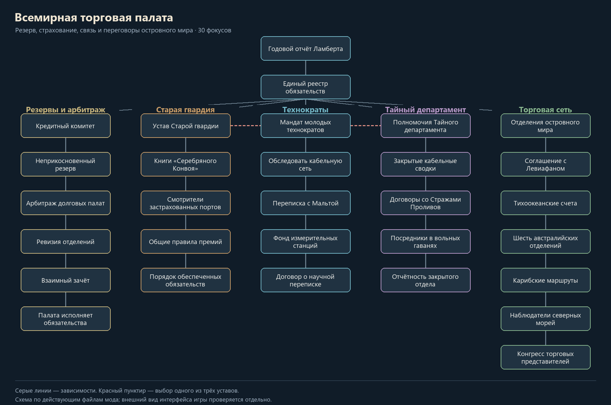

# ВТП и островная сеть — 31 октября 2026

Добавлен экономический и дипломатический слой для остальных фракций. Всемирная торговая палата остаётся игровой страной A04 с центром в Фуншале и одновременно обслуживает общую долговую книгу. Ламберт сохраняет неизвестную личность. Обновление рассчитано на новую кампанию 1893 года.

## Деревья стран

148 новых фокусов в 15 деревьях. Всего в моде теперь 404 фокуса. Каждая зарегистрированная страна, кроме технической пустоши ZZZ, получает ровно одно подходящее дерево. Общие деревья используются каждым участником самостоятельно: счета, решения и полученные награды принадлежат отдельной стране.

| Страна или группа | Фокусов в дереве | Содержание |
| --- | ---: | --- |
| ВТП | 30 | Общий реестр, кредитный комитет, резерв, арбитраж, три устава директората, иностранные отделения |
| Британский Левиафан | 10 | Счета стоянок, собственные сборы или расчёты с Палатой, нефть Батавии, колониальные представители, Мальта |
| Исландская Россия | 9 | Двор и канцелярия, зимние запасы, местное финансирование или научные поставки, мальтийская переписка |
| Осака | 9 | Векселя торговых домов, сокращение заказов или расчётная палата, работа с Токио и Хакодате |
| Северная армия | 8 | Зимние склады, общинные заказы или страхование поставок, отдельные переговоры с югом |
| Железный Союз | 9 | Гаванские счета, лоцманы, внешние торговые представители, доковые команды |
| Рыцари Конфедерации | 8 | Плантационные обязательства, экспорт, склады Санта-Клары, торговые посланники |
| Ацтекское Возрождение | 8 | Совет штабов и служителей Пророка, береговые запасы, внешние поставки |
| Дети Урагана | 8 | Общинные книги, собственные сборы или страхование, прибрежные склады и рейсы |
| Гавайи | 8 | Королевский совет, нейтральная гавань, мастерские Гонолулу, иностранные капитаны |
| Мальта | 8 | Двор, приборы, лабораторные поставки, переписка с Исландией и Британией |
| Шесть австралийских колоний | 9 | Собственные бюджеты и договоры, межколониальная переписка, признание грузовых ведомостей |
| Кутай, Понтианак, Банджар, Ачех | 8 | Совет двора и гавани, портовые обязательства, независимая торговая дипломатия |
| Филиппинские правительства и республики | 8 | Собственные счета и снабжение, отдельная делегация в Палату, приёмка грузов |
| Прочие малые островные государства | 8 | Портовый совет, местные ресурсы, ремонт и морские соглашения |

Действующие деревья Ост-Индии, Японии и Конфедерации Филиппин сохранены. Неактивные теги получили подходящие определения фокусов, но новые владения или армии им не назначались.

В деревьях стран есть взаимоисключающий выбор между оплатой своими средствами и открытием переговоров с Палатой. Собственное финансирование сокращает долг ценой небольшой потери стабильности; торговая делегация открывает предложение, которое ВТП может принять или отклонить. Обе политики ведут к местным мастерским и последующим переговорам с соседями. Организация местных служб создаёт одну гражданскую фабрику в собственной контролируемой столице; завершение программы добавляет вторую. ВТП получает свою конторскую и портовую мастерскую через единый реестр и расширяет её в конце финансового направления. Северная армия и центральнокубинские поместья получают по одной военной фабрике через отдельный оружейный проект: на старте у них не было собственного военного производства.

## Игра за ВТП

Это схема действующих файлов, а не снимок интерфейса игры.

Два начальных фокуса открывают пять направлений. Финансовое направление и иностранные отделения доступны при любом уставе; Старая гвардия, технократы и Тайный департамент предлагают три взаимоисключающих долгосрочных устава. Существующие решения о текущем приоритете групп сохраняются.

- **Финансы:** адресные предложения кредитов, дополнительный резерв, частичное списание долгов, проверка отделений и взаимный зачёт.
- **Старая гвардия:** страховые книги, смотрители портов, общие премии и обеспеченные обязательства. Действующий приоритет банкиров по-прежнему меняет цену страховых договоров.
- **Технократы:** кабельное обследование, переписка с Мальтой, измерительные станции и научные договоры.
- **Тайный департамент:** кабельные сводки, наёмные Стражи Проливов, посредники в вольных гаванях и закрытая отчётность. Пиратские контакты снижают репутацию.
- **Иностранные отделения:** Британия, Тихий океан, отдельные австралийские кабинеты, Карибы и северные наблюдатели.

Фокусы развивают торговые, финансовые и научные службы. Охрана Мадейры обозначена как наёмная контрактная охрана; дерево не выдаёт регулярных армий или территориальных приобретений.

## Мировая долговая книга

В решениях A04 появилась категория «Мировая долговая книга»:

- доступный кредитный резерв и репутация, каждый показатель от 0 до 100;
- суммарный индекс обязательств, число долговых счетов и счетов с долгом выше 70;
- число действующих соглашений непосредственно с Палатой;
- адресная проверка счетов с текущим долгом каждой страны;
- адресный кредит и адресное списание после соответствующих фокусов;
- чрезвычайные взносы и приостановка новых кредитных линий.

Сумма индексов долга — условный показатель обязательств, а не количество денежных единиц. Сводка обновляется ежемесячно, при проверке счёта и при основных договорных операциях. Новая казна инициализируется один раз: резерв 60, репутация 50. Существующий долг стран не обнуляется. Учёт обязательств закреплён за тегом страны; автоматическое правопреемство долга при распадах и аннексиях остаётся отдельным этапом.

Ежемесячное пополнение резерва: +3 базово, +2 при наличии должников, ещё +1 при более чем двух соглашениях Палаты. «Неприкосновенный резерв» и «Общие правила премий» добавляют по +1. Более четырёх проблемных счетов отнимают 3 резерва и 1 репутации; отсутствие британского прикрытия отнимает ещё 2 резерва. Обычная выплата должника возвращает Палате 3 резерва. Все значения ограничиваются шкалой 0–100. Это балансировочные параметры первой версии сети.

| Действие | Цена | Результат |
| --- | --- | --- |
| Предложить целевой кредит | ВТП: 15 политической власти, 10 резерва | Должник получает предложение; принятие даёт 15 транспортов и 75 вспомогательного оснащения за 15 долга |
| Запросить целевую поставку | Должник: 20 политической власти; Палата резервирует 10 | Те же условия поставки; страна сама выбирает ответ на договор |
| Стандартный морской кредит | Должник: 35 политической власти; Палата расходует 10 резерва | Существующие 25 транспортов за 20 долга |
| Частичное списание | ВТП: 35 политической власти, 8 резерва | −12 долга выбранной стране; повторное списание ей через 360 дней |
| Чрезвычайные взносы | ВТП: 100 политической власти | +20 резерва, −3 репутации; интервал 180 дней |

Приостановка кредитных линий закрывает новые стандартные и целевые кредиты. Уже зарезервированные предложения продолжают действовать до ответа или истечения срока.

Предложение удерживает средства до 30 дней. Отказ, потеря доступности, пропавший ответ или исчезновение должника возвращают резерв. Для этого Палата хранит отдельные записи по всем 40 зарегистрированным контрагентам; повторный ответ, повторная очистка и восстановление исчезнувшей страны не возвращают средства дважды. Принятие расходует резерв окончательно. Действующий заём начисляет дополнительный долг в течение 180 дней.

Сохраняются существующие обслуживание и пороги долговой книги: ежемесячная цена ненулевого долга, военные расходы, концессии выше 70, ограничения выше 90 и долговой кризис при 100. После полного погашения флаг активного займа снимается, поэтому проценты не создают погашенный долг заново. Дробное значение 99,99 больше не считается достижением 100. Ответы на требования концессий, санкции и долговой кризис повторно проверяют условия и расходуют право ответа один раз.

## Договоры и интересы стран

Через «Торговые представительства» страна с открытым отделением предлагает Палате годовое обслуживание. ВТП отвечает отдельным событием. Принятие добавляет 5 долга; британские морские услуги вместо этого уменьшают долг на 5. Получатель получает соответствующие услуги: британские стоянки, осакские расчёты, северное снабжение, научную переписку, карибское охранение, колониальные или островные склады.

Палата может отказать. Отправителю приходит донесение об успехе, отказе или истечении срока переписки. Расторжение прекращает договорные услуги с сохранением принятого долга. Награды внутренних фокусов хранятся отдельно и при расторжении сохраняются. Война с Палатой, исчезновение участника или капитуляция прекращают действующее обслуживание.

Британия после самостоятельной адмиралтейской политики может отдельно отозвать прикрытие ВТП. Чёрный список снимается сразу у должников; кабельные ограничения остаются самостоятельным рычагом Палаты. Смена долгового кабинета без прикрытия срывается. Прикрытие также прекращается при исчезновении Британии, её капитуляции или войне с A04. Возобновление прикрытия требует мира.

## Прямые межгосударственные связи

Добавлено 147 направленных предложений для 107 пар стран. Инициатор платит 25 политической власти и отправляет делегацию; партнёр подтверждает договор отдельным событием. Отправитель получает донесение об исходе. Отсутствие ответа закрывает переписку, а повторный ответ не продлевает договор и не выдаёт награды заново.

Все соглашения дают общую морскую координацию +2% на 360 дней. Некоторые связи дополнительно обеспечивают профильные услуги:

| Связь | Дополнительная услуга обеим сторонам |
| --- | --- |
| Токио — Осака | Рост эффективности производства +2% |
| Хоккайдо — Токио / Осака | Расход снабжения −2% |
| Британия — Батавия | Морской расход снабжения −3%; обслуживание торговых рейсов без автоматической передачи нефти |
| Исландия — Мальта | Скорость исследований +2% |
| Австралийские колонии между собой и с Британией | Скорость строительства +2% |
| Карибские участники и внешние торговые партнёры | Эффективность эскортов +2% |

Одинаковые услуги от нескольких партнёров не складываются; разные виды могут действовать одновременно. Война между сторонами, капитуляция или исчезновение партнёра прекращают соответствующую связь. Потеря одной связи сохраняет услуги остальных действующих соглашений. Истечение последнего договора снимает его преимущества.

Договоры морских служб сохраняют существующие правительства, долги, союзы и границы. Конвенции шести австралийских кабинетов не образуют федерацию. Действующая отдельная филиппинская ветка A10W со своими добровольными хартиями сохраняет собственные условия.

## Проверка и продолжение

Общий набор: `py tools/check_current_content.py` — **20 из 20 проверок**. Новый модуль: `py tools/validate_chamber_network.py` — **1710 сценариев**, включая исполнение всех 148 наград фокусов, пороги резервов и долга, все направленные переговоры, просрочки, повторные ответы, исчезновение стран, возврат резерва, отдельные договорные бонусы и месячные начисления. Дополнительно проверяются назначения деревьев, связи фокусов, расположение, локализация, названия условий и эффектов, модификаторы и изображения установленной игры.

Это статическая проверка и ограниченное исполнение скриптов. Запуск HOI4, внешний вид нативного интерфейса, дипломатический ИИ, промышленный баланс и полная кампания ещё требуют игрового прогона.

Следующие содержательные блоки: полноценные политические развилки двора и церкви в Исландии, военные кампании карибских соперников, отдельные политические ветки малых филиппинских правительств, развитие северных экспедиций и исследовательской цепочки артефакта. Настоящее обновление создаёт для них действующие финансовые и дипломатические связи.

Источники нового содержимого: `tools/build_chamber_network.py` и `tools/build_island_relations.py`. Они записывают файлы пространства `WTN`; старые миграционные генераторы не запускаются. Основные механики в `common/scripted_effects/WTN_network.txt` и `common/scripted_triggers/WTN_network.txt` редактируются непосредственно. Схема дерева: `py tools/render_chamber_tree.py`.
